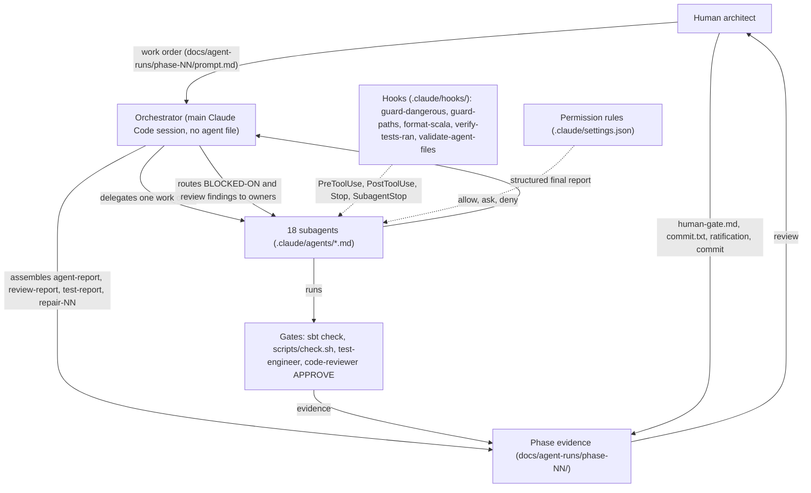
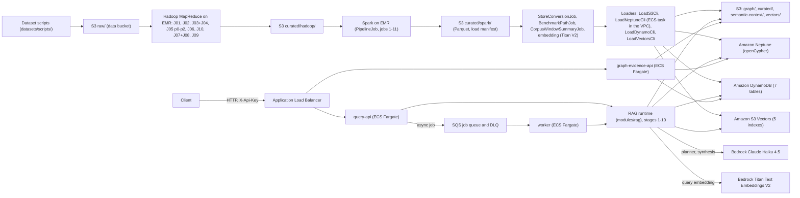

# ScholarChain architecture

Owner: documentation-engineer. This file shows the two halves of ScholarChain: the build-time agentic factory that produced the repository, and the runtime system that the factory built. Ownership, routing, and gates are defined only in [`docs/agents.md`](agents.md) and [`CLAUDE.md`](../CLAUDE.md); this file references them and does not restate their rules. Per-component details live in the module documents linked below.

## 1. Build time: the agentic software factory

| Component | Role |
|---|---|
| Human architect | Writes each phase work order and its rulings in `docs/agent-runs/phase-NN/prompt.md`, approves plans, applies, cleanups and constitutional changes, runs the cloud windows, and accepts or rejects each phase in `human-gate.md` (spec "Human architect responsibilities"; `docs/agents.md` "Escalation policy and human gates"). |
| Orchestrator | The main Claude Code session. It has no file under `.claude/agents/`. It delegates to the owning subagent, routes `BLOCKED-ON` results and findings, and writes only the report files it assembles into `docs/agent-runs/` (`docs/agents.md` "Topology"). |
| Subagents | 18 role files under `.claude/agents/`, one writer per artifact class, no agent-to-agent calls (hub and spoke). The README [agent catalog](../README.md#agent-catalog) lists each one. |
| Hooks | `guard-dangerous.sh` (PreToolUse on Bash and MCP: destructive cloud, Terraform, Git and secret-reading commands), `guard-paths.sh` (PreToolUse on file tools: ownership map and secret paths), `format-scala.sh` (PostToolUse formatter), `verify-tests-ran.sh` (Stop and SubagentStop: tests must be newer than changed sources), `validate-agent-files.sh` (constitution validator). Their limits are listed in `docs/agents.md` "Hook limitations". |
| Permission rules | `.claude/settings.json` allow, ask and deny lists; bypass mode disabled. |
| Gates | `sbt check` (definition of done in `CLAUDE.md`), `scripts/check.sh` (every non-cloud gate), the test-engineer run (Phase 11), and a code-reviewer `APPROVE` before each phase gate. |
| Phase evidence | `docs/agent-runs/phase-NN/`: prompt, reports, repairs, human gate, accepted commit. Format: [`docs/agent-runs/README.md`](agent-runs/README.md). |

## 2. Runtime: data pipeline, stores, and services

| Component | What it does | Source |
|---|---|---|
| Dataset scripts | Bounded, idempotent fetch and sampling of DBLP (snapshot 2026-10-03), OpenAlex, Crossref and ORCID (snapshots 2026-11-03), DOI-driven from a 46-venue DBLP subset; validation by `bash datasets/scripts/validate.sh`. | [`datasets/dataset-manifest.yaml`](../datasets/dataset-manifest.yaml) |
| S3 raw | One data bucket per environment, `scholarchain-course-data-<account-id>-us-east-2`, with the prefixes `raw/`, `curated/`, `graph/`, `semantic-context/`, `vectors/`, `reports/`, `logs/`, `runs/` (plus `artifacts/` for jars and image contexts). | [`modules/storage/STORAGE.md`](../modules/storage/STORAGE.md), [`infra/terraform/README.md`](../infra/terraform/README.md) |
| Hadoop on EMR | Java MapReduce API from Scala 3, driver `scholarchain.hadoop.Pipeline`. J01 DBLP extraction (records never split across mappers), J02 source normalization, J03+J04 exact identifiers, J05 blocking (three passes), J06 candidate join, J10 match decisions (map-only), J07+J08 publication teams and n(n-1)/2 pair expansion, J09 Spark-ready export. Ephemeral cluster per run, `emr-spark-8.0.0`, 1 primary plus up to 2 core `m6g.xlarge`. | [`modules/hadoop/JOBS.md`](../modules/hadoop/JOBS.md), [`scripts/README.md`](../scripts/README.md) `run-bounded-pipeline.sh` |
| Spark on EMR | `scholarchain.spark.PipelineJob` runs CanonicalGraphJob (jobs 1, 2), ResearcherAnalyticsJob (3, 4, 8), CommunityPathJob (5, 6, 7) and TemporalSummaryExportJob (9, 10, 11): canonical researchers, the temporal weighted coauthorship graph, P_r to W_r, components, bounded paths, label-propagation communities, three bridge measures, k-core, temporal comparison, summaries and the load manifest. On EMR it completed at 25 percent and ran out of memory in job 10 at 50 and 100 percent (P14-D8); the served graph comes from the local full run. | [`modules/spark/JOBS.md`](../modules/spark/JOBS.md), [`docs/evaluation.md`](evaluation.md) sections 5.2 and 7 |
| Loaders | StoreConversionJob writes the store files (Neptune CSV, DynamoDB item files, evidence objects, embedding candidates); the storage CLIs load them. Neptune runs in private subnets, so `LoadNeptuneCli` runs as a one-off ECS task inside the VPC. `scripts/load-stores.sh` (human-run) loads S3, Neptune, DynamoDB and S3 Vectors in that order. | [`modules/storage/STORAGE.md`](../modules/storage/STORAGE.md), [`scripts/README.md`](../scripts/README.md) `load-stores.sh` |
| S3 | Authoritative text and evidence objects, run manifests, write-once runtime audits (`logs/rag-runtime/`) and stored answers (`reports/rag-runtime/`). | [`modules/storage/STORAGE.md`](../modules/storage/STORAGE.md) |
| Neptune | Engine 1.4.8.1 on `db.t4g.medium` (bulk loads ran on `db.r6g.large`, then the instance went back); vertices Researcher, Work, Venue, Institution, Topic, Community; edges AUTHORED, COAUTHORED_WITH, PUBLISHED_IN, AFFILIATED_WITH, HAS_TOPIC, MEMBER_OF. Runtime grant `neptune-db:ReadDataViaQuery` only; parameterized query templates with depth, result and timeout bounds. | [`modules/storage/STORAGE.md`](../modules/storage/STORAGE.md), [`infra/terraform/README.md`](../infra/terraform/README.md) |
| DynamoDB | Seven on-demand tables, including ResearcherMetricCache (`WINDOW#`, `CHANGE#`, `RANKING#` items), EntityLinkCache, ArtifactRegistry, QuerySession, EvidenceBundle (GSI `evidenceById`) and ServiceState (TTL on `expiresAt`). | [`infra/terraform/README.md`](../infra/terraform/README.md) "DynamoDB" and "IAM summary" |
| S3 Vectors | One vector bucket with five indexes (`researcher-profile-v1`, `collaboration-community-v1`, `paper-abstract-v1`, `collaboration-path-v1`, `topic-institution-summary-v1`), float32, 1024 dimensions, cosine; long text stays in S3 (`semantic-context/text/`) and the vector metadata keeps a `textRef`. | [`infra/terraform/README.md`](../infra/terraform/README.md) "S3 Vectors", [`modules/storage/STORAGE.md`](../modules/storage/STORAGE.md) |
| ALB | Public, HTTP on port 80 (no certificate in the course window, so the API key travels in clear text; Phase 12 ruling 11). Routes `/v1/query`, `/v1/jobs/*`, `/v1/explain/*`, `/healthz`, `/readyz` to query-api and `/v1/evidence/*`, `/v1/graph/*` to graph-evidence-api; `/metrics` is not routed. | [`infra/terraform/README.md`](../infra/terraform/README.md) "ECS and the ALB" |
| query-api | Fargate ARM64 task, port 8080: `POST /v1/query` (sync runs the workflow under the 40 s deadline; async writes a job and one SQS message), jobs, results, explain. | [`modules/services/SERVICES.md`](../modules/services/SERVICES.md), [`docs/api-reference.md`](api-reference.md) |
| graph-evidence-api | Fargate ARM64 task, port 8081: evidence by ID, graph node, bounded neighbors. No model calls. The only service with a scaling maximum above 1 (target-tracking on CPU). | same |
| SQS and worker | Job queue (visibility 300 s, redrive to the DLQ after 3 receives) and a worker (port 8082, health and metrics only) that moves jobs QUEUED, RUNNING, SUCCEEDED or FAILED with conditional writes. | [`infra/terraform/README.md`](../infra/terraform/README.md), [`modules/services/openapi.yaml`](../modules/services/openapi.yaml) |
| RAG runtime | Ten stages: query planning (Haiku, validated against an operation allowlist, rule-planner fallback), researcher resolution (`dominant-name-v1`, abstains on ambiguity), collaboration metrics, path finding, community analysis (all deterministic store reads), semantic context (one Titan embedding, filtered vector queries), evidence building, answer synthesis (Haiku), rule-based claim verification, and a write-once audit. Facts come from the stores; vector similarity only selects descriptive text. | [`modules/rag/RUNTIME.md`](../modules/rag/RUNTIME.md) sections 1 and 2 |
| Bedrock | `us.anthropic.claude-haiku-4-5-20251001-v1:0` (cross-Region inference profile) for planning and synthesis, `amazon.titan-embed-text-v2:0` for embeddings; throttled per process by `runtime.llm.requests-per-minute`. | [`modules/core/src/main/resources/scholarchain.conf`](../modules/core/src/main/resources/scholarchain.conf), [`infra/terraform/envs/course/course.tfvars`](../infra/terraform/envs/course/course.tfvars) |

All AWS resources come from Terraform under [`infra/terraform/`](../infra/terraform/README.md) in two stages (`runtime_enabled` false, then true); EMR clusters are ephemeral and launched by `scripts/run-bounded-pipeline.sh`. The runtime stage was destroyed on Nov 20, 2026 ([`operations/cleanup/cleanup-20261120T041658Z-runtime/`](../operations/cleanup/cleanup-20261120T041658Z-runtime/record.json)); see the README "Known limitations".
